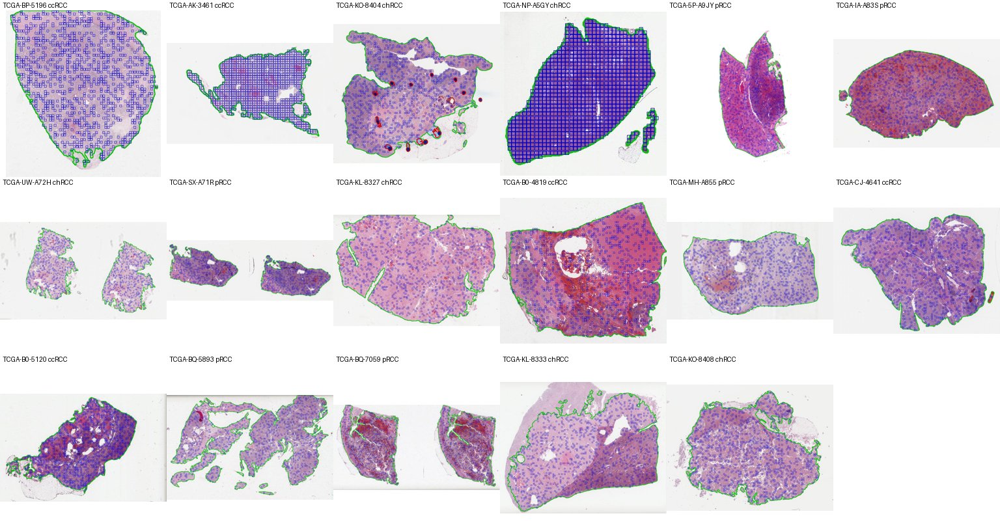

# Slide QC report

Processed 18 slides: 17 retained, 1 excluded. Tiles: 224 px at 1.0 um/px, up to 1000 sampled per slide, minimum 50 tissue patches.

## Retained slides

| track   | label   |   slides |   median_patches |   min_patches |   median_blur |   shard_gb |
|:--------|:--------|---------:|-----------------:|--------------:|--------------:|-----------:|
| B       | ccRCC   |        5 |           2760   |           978 |       3913.4  |       0.14 |
| B       | chRCC   |        6 |           4062   |           886 |        869.35 |       0.14 |
| B       | pRCC    |        6 |           4515.5 |          3287 |       1767.55 |       0.17 |

Blur score: median variance of the Laplacian over a slide's sampled patches (exclusion threshold 0). Lowest retained: 547.0; 5th percentile: 634.4399999999999.

## Excluded slides

| slide_id                | label   | reason                               |
|:------------------------|:--------|:-------------------------------------|
| TCGA-CJ-4889-01Z-00-DX1 | ccRCC   | mostly pen marks (pen fraction 0.98) |

## Contact sheet (17 random retained slides)

Green: tissue contour; red: detected pen marks; blue: sampled patches.

